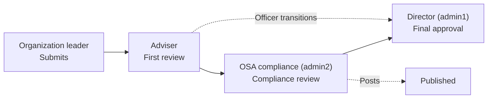

<p align="center">
  
</p>

<h1 align="center">UMunity</h1>

<p align="center">One platform for every student organization at the University of Mindanao. Students discover and join organizations, leaders run events and posts, and advisers and the Office of Student Affairs review each step in one place.</p>

<p align="center"><code>Organization Management System V.2</code> &nbsp; <code>React 19 + TanStack Start</code> &nbsp; <code>Tailwind CSS 4</code> &nbsp; <code>Turso / SQLite</code></p>

<p align="center">
  <a href="#run-locally"></a>
  <br>
  <sub>Development needs no accounts: the app creates a local SQLite database and seeds demo users on first run.</sub>
</p>

<p align="center">
  <a href="#at-a-glance"><strong>At a glance</strong></a> &nbsp;·&nbsp;
  <a href="#roles"><strong>Roles</strong></a> &nbsp;·&nbsp;
  <a href="#how-it-works"><strong>How it works</strong></a> &nbsp;·&nbsp;
  <a href="#run-locally"><strong>Run locally</strong></a> &nbsp;·&nbsp;
  <a href="#database"><strong>Database</strong></a> &nbsp;·&nbsp;
  <a href="#explore-the-repository"><strong>Explore the repository</strong></a>
</p>

## At a glance

<table>
  <tr>
    <td align="center" width="25%"><strong>01 · Discover</strong><br><sub>Browse recognized organizations by interest, mission, and campus culture</sub></td>
    <td align="center" width="25%"><strong>02 · Participate</strong><br><sub>Join events, RSVP quickly, and stay updated</sub></td>
    <td align="center" width="25%"><strong>03 · Connect</strong><br><sub>Follow communities, announcements, and messages</sub></td>
    <td align="center" width="25%"><strong>04 · Lead</strong><br><sub>Manage members, publish updates, and run your organization</sub></td>
  </tr>
</table>

## Roles

Each role signs in to its own workspace. In development, the sign-in page lists one demo account per role.

| Role | Workspace | What they do |
| --- | --- | --- |
| **Student** | `/student` | Home feed, explore and join organizations, events and RSVPs, saved items, messages, and organization finances |
| **Organization leader** | `/leader` | Events and event workflows, requirements, attendance, posts, members and join requests, finance, accreditation, and officer transitions |
| **Adviser** | `/adviser` | First review of event workflows, posts, requirements, accreditation, and officer transitions; analytics and member activity |
| **OSA compliance officer** (`admin2`) | `/admin2` | Monitoring, Review Center, compliance, requirements, finance, and post publishing |
| **Director of Student Affairs** (`admin1`) | `/admin1` | Final authority on accreditation, event workflows, and officer transitions; organizations, finance, and governance |
| **System administrator** (`admin`) | `/admin` | Users, organizations, events, announcements, reported posts and comments, reports, and activity logs |

## How it works

Leaders submit work; reviewers approve it in order. The server checks every save against the review rules in [src/lib/review-rules.ts](src/lib/review-rules.ts) and refuses a step the signed-in role may not take.



| Item | Review chain |
| --- | --- |
| Event workflows and accreditation | Adviser → OSA compliance → Director → approved (events also have a post-event closeout) |
| Officer transitions | Adviser → Director → completed |
| Organization posts | Adviser → OSA compliance → published |

## Run locally

You need **Node.js** and npm.

```powershell
npm install
npm run dev
```

Open **http://localhost:8080** (or the port Vite prints) and sign in with one of the demo accounts listed on the sign-in page.

| Command | Purpose |
| --- | --- |
| `npm run dev` | Start the development server |
| `npm test` | Run the automated tests (Vitest) |
| `npm run lint` | Check the code with ESLint |
| `npm run build` | Build for production |

## Database

Accounts, sessions, and app data are stored in a free [Turso](https://turso.tech) database. Development needs no setup: the first request creates `local.db` (SQLite), builds the tables, and seeds the demo accounts. Delete `local.db` to start over.

To deploy, set `TURSO_DATABASE_URL`, `TURSO_AUTH_TOKEN`, `APP_URL`, and (for password-reset email) `RESEND_API_KEY` and `RESET_EMAIL_FROM`; see [.env.example](.env.example). Demo accounts are disabled in production. See [docs/DATABASE.md](docs/DATABASE.md) for setup and how it works.

## Explore the repository

| Area | Start here | What you will find |
| --- | --- | --- |
| Pages | [src/routes/](src/routes/) | Public pages and one route group per role |
| Components | [src/components/](src/components/) | Dashboard layout, events, finance, workflows, social feed, and shared UI |
| Server and data | [src/lib/core.server.ts](src/lib/core.server.ts) · [src/lib/db.server.ts](src/lib/db.server.ts) | Sessions, database access, and review-rule enforcement |
| Workflows | [src/lib/workflows.ts](src/lib/workflows.ts) · [src/lib/review-rules.ts](src/lib/review-rules.ts) | Event proposals, closeouts, officer transitions, and approval chains |
| Tests | [src/lib/*.test.ts](src/lib/) | Core server, finance, and synced-storage tests |
| Project documents | [docs/](docs/) | Charter, requirements, WBS, timeline, risk register, QA, and closure report |
